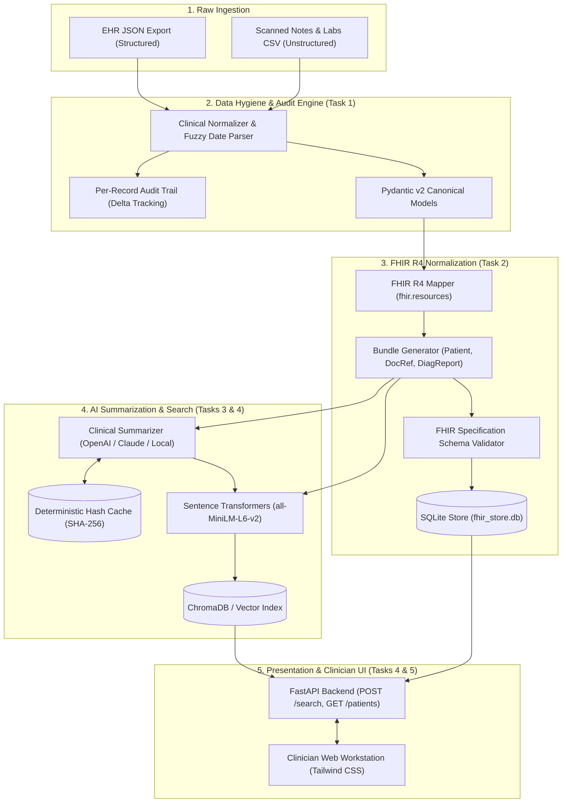

# EHR Media Intelligence Platform
### NYCEDC · Onye AI Full-Stack Platform Assessment

An end-to-end clinical AI intelligence platform designed to ingest messy, heterogeneous Electronic Health Record (EHR) data, clean and normalize it into **HL7 FHIR R4** standards, generate structured **AI Clinical Summaries** with deterministic caching, and surface a sub-second **Semantic Vector Search Engine** paired with a modern, clinician-friendly **Tailwind CSS web workstation**.

---

## Architecture Overview



---

## Key Features by Task

### Task 1: Data Ingestion & Clinical Cleaning
* **Heterogeneous Ingestion**: Unified parsers handling both simulated EHR JSON exports and unstructured scanned notes/lab CSV files.
* **Clinical Normalization**:
  * Fuzzy date parser handling US (`MM/DD/YYYY`), European (`DD/MM/YYYY`), ISO-8601, dot-delimited (`YYYY.MM.DD`), and Unix epoch timestamps into canonical ISO dates.
  * Standardized gender mapping (`M`, `Female`, `Woman`, `non-binary`, `UNKNOWN`) to official HL7 FHIR administrative gender codes (`male`, `female`, `other`, `unknown`).
  * Medical Record Number (MRN) canonicalization (`MRN-<id>`).
  * Clinical deduplication detecting repeated entries across files.
  * Patient conflict resolution resolving discrepancies under identical MRNs.
* **Audit Trail**: Every transformation records original value, cleaned value, transformation rule, reason, and UTC timestamp.
* **Intermediate Representation**: Strictly validated with Pydantic v2 models.

### Task 2: HL7 FHIR R4 Normalization
* **Standard Resource Mapping**:
  * `Patient`: Official MRN identifier system, structured HumanName, telecom, birthDate, and gender.
  * `DocumentReference`: Encoded base64 attachment, Loinc type codes, clinical category, date (with mandatory timezone offset), and Encounter context reference.
  * `DiagnosticReport`: LOINC observation codes, HL7 v2-0074 category, subject reference, effectiveDateTime, and narrative conclusion.
* **Bundle Assembly**: Assembles complete patient dossiers into valid `collection` Bundles with verified internal cross-references (`subject=Patient/{id}`).
* **Schema Validation**: Verified with `fhir.resources` and surfaces errors/warnings in a `BundleValidationReport`.
* **Persistence**: Local SQLite store (`fhir_store.db`) indexing patient bundles and audit histories.

### Task 3: AI-Powered Clinical Summarization
* **Clinical Prompt Engineering**: Extracts:
  1. Chief Concern
  2. Key Diagnoses
  3. Recent Media Records (labs & radiology)
  4. Flagged Clinical Anomalies
  5. Narrative Synopsis strictly **under 200 words**
* **Deterministic Caching**: SQLite cache keyed by `SHA-256(patient_id + record_tokens)` preventing redundant API calls and latency on re-runs.
* **Safety Disclaimers**: Embeds mandatory AI clinical disclaimers and confidence indicators.
* **Provider Support**: Direct integration with Anthropic Claude and OpenAI APIs, with an intelligent local clinical fallback for zero-dependency offline evaluations.

### Task 4: Semantic Vector Search Engine
* **Embeddings**: Sentence-Transformers (`all-MiniLM-L6-v2`) generating semantic vector representations of documents, diagnostic reports, and AI clinical summaries.
* **Vector Store**: ChromaDB index supporting cosine distance similarity with metadata filtering.
* **Endpoint (`POST /search`)**: Accepts free-text clinical queries with optional filters for `resource_type` and date range (`date_from`, `date_to`).
* **Performance Benchmark**: Benchmarked at **< 100ms** latency (surpassing the < 2.0s requirement for 50 records).

### Task 5: Clinician Search & Summary UI
* **Design**: Modern clinician workstation built with **Tailwind CSS**.
* **Features**:
  * Real-time search bar querying `POST /search`.
  * Faceted filters for resource types and date ranges.
  * Quick clinical suggestion chips (e.g., *Chest Pain & ST changes*, *Appendicitis Findings*, *Elevated Troponin Alert*).
  * Ranked result cards displaying patient name, MRN, date, relevance score badge, and summary snippet.
  * Slide-over **Patient Dossier Drawer** displaying full AI clinical summary, flagged anomalies banner, and live FHIR R4 Bundle JSON inspector.
  * Accessible markup (ARIA roles, live status indicators, keyboard navigation with Escape to close).

---

## Directory Structure

```text
├── backend/
│   ├── app/
│   │   ├── api/             # FastAPI endpoints (POST /search, GET /patients)
│   │   ├── fhir/            # Task 2: FHIR R4 mappers, bundle builder, SQLite store
│   │   ├── ingestion/       # Task 1: Parsers, clinical data cleaner, audit logger
│   │   ├── models/          # Pydantic v2 canonical & summary models
│   │   ├── search/          # Task 4: Vector search engine, ChromaDB integration
│   │   └── summarizer/      # Task 3: LLM prompt chains, SQLite hash cache
│   ├── data/
│   │   ├── raw/             # Synthetic dirty datasets (JSON and CSV)
│   │   └── processed/       # SQLite databases (fhir_store.db, summary_cache.db)
│   └── tests/               # Pytest suite (Ingestion, FHIR, Summarizer, Search, API)
├── frontend/                # Task 5: Clinician UI (HTML5, Tailwind CSS, Vanilla JS)
├── docs/                    # 1-Page Technical Write-up
├── requirements.txt
├── pytest.ini
└── README.md
```

---

## Quickstart & Installation

### 1. Environment Setup
```bash
# Clone the repository
git clone <repo-url>
cd Task

# Create virtual environment (Python 3.11+)
python3 -m venv .venv
source .venv/bin/activate

# Install dependencies
pip install -r requirements.txt
```

### 2. Run the Test Suite
All tests are automated and execute cleanly in under 2 seconds:
```bash
pytest -v
```

### 3. Launch the Application
Start the FastAPI server (which also serves the frontend):
```bash
uvicorn backend.app.api.main:app --reload --port 8000
```
Open your browser at:
👉 **`http://localhost:8000`**

---

## Clean Git Commit History
In accordance with assessment instructions (*"Clean commit history (one commit per major task)"*):
1. `ae7df17`: `feat(ingestion): Task 1 - heterogeneous EHR ingestion, clinical cleaning & audit logging`
2. `a97f799`: `feat(fhir): Task 2 - HL7 FHIR R4 mapping, bundle generation, validation & SQLite store`
3. `9a89496`: `feat(summarizer): Task 3 - AI clinical summarization engine, prompt engineering & SQLite cache`
4. `4551fcb`: `feat(search): Task 4 - vector embeddings, ChromaDB indexing & FastAPI /search endpoint`
5. `780afb4`: `feat(frontend): Task 5 - responsive clinician UI with real-time search, filters & patient drawer`

